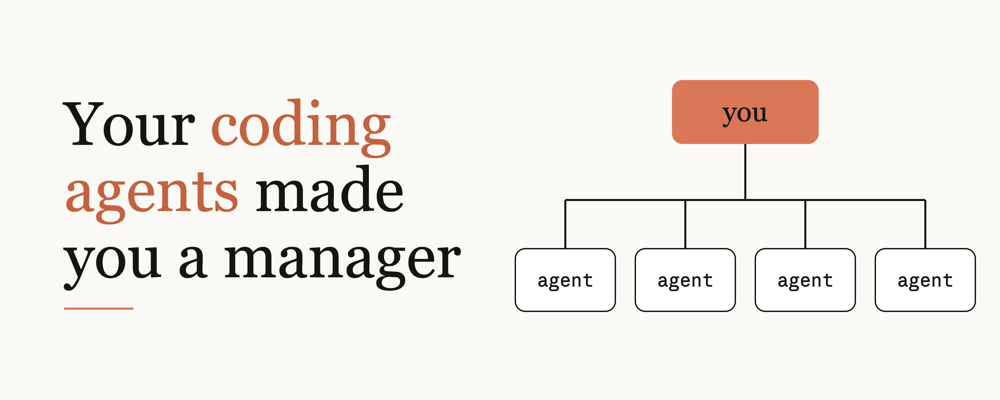

# 你的编程智能体，让你成了管理者

## Your coding agents made you a manager



*用户提供的文章配图。图左为标题，右侧表示由你协调多个智能体的关系；图片中的文字属于学习材料。*

**原作者：Addy Osmani（@addyosmani）**  
**来源：用户提供的完整正文与图片，未提供原文链接或发布日期。**  
**学习结构：95 个段落／清单条目逐项中英对照，附每段好词、好句、句型拆解和中英仿写。**

> 译文保留作者第一人称及原文语气；分析和仿写为学习补充，不是作者原话。文中产品功能、默认设置与研究结论按作者说法翻译，未另行核验。命令、提示词和图片文字均为学习材料，不在本任务中执行。

## 阅读方法

先独立读英文原段，再用中文核对；之后学习词组与句型，最后遮住仿写英文，根据中文尝试复述。文中的最佳实践、反面模式和短清单单独编号，保留原文顺序。

## 目录

- [导语：为什么你已经在做管理](#section-0)
- [给它验证自己工作的办法](#section-1)
- [提供清晰的上下文](#section-2)
- [让每次纠错都积累价值](#section-3)
- [让它作决定，只对不可妥协的要求强制执行](#section-4)
- [先计划，再动手](#section-5)
- [尽早引导，迅速重来](#section-6)
- [委派任务，保留判断](#section-7)
- [设计无需你守着的自主运行](#section-8)
- [扩大验证能力，而非注意力投入](#section-9)
- [决定哪些事情不做](#section-10)
- [类比在哪些地方不成立](#section-11)
- [你不需要管理者头衔](#section-12)
- [术语速查](#terms)
- [优先复习句型](#patterns)

---

<a id="section-0"></a>

## 导语：为什么你已经在做管理

### 第 01 段

**英文原文**

> The skills for managing agents are pretty much the skills for managing a team, and you don't need to be a manager to learn them.

**中文翻译**

管理智能体所需要的技能，基本上就是管理团队所需要的技能；而要学习这些技能，你并不需要先成为管理者。

**好词与搭配**

- **pretty much**：基本上、差不多，较口语化。
- **the skills for doing ...**：做某事所需的技能。

**好句**

> you don't need to be a manager to learn them.

**句型拆解**：don't need to ... to ... 表示实现后者不必先满足前者；them 指管理技能。

**仿写**：You don't need to be a researcher to learn how to evaluate evidence.  
**仿写译文**：学习如何评估证据，并不需要先成为研究人员。

### 第 02 段

**英文原文**

> If you're spending all day with a coding agent, you are managing. You're repeatedly selecting tasks, writing instructions, delegating, following up, evaluating results, and deciding what ships. The engineers who get the most out of agents aren't necessarily the ones who are best at prompt engineering. They're the ones who learned how to manage, intentionally or otherwise.

**中文翻译**

如果你整天都在和编程智能体一起工作，那你就在做管理。你不断挑选任务、编写指令、委派工作、跟进进度、评估结果，并决定哪些成果可以发布。那些最能发挥智能体价值的工程师，未必最擅长提示词工程；他们是有意或无意地学会了管理的人。

**好词与搭配**

- **get the most out of**：最大限度地发挥……的价值。
- **follow up**：跟进。
- **intentionally or otherwise**：有意或无意地；otherwise 在这里涵盖非有意的情况。

**好句**

> The engineers who get the most out of agents aren't necessarily the ones who are best at prompt engineering.

**句型拆解**：aren't necessarily 表示未必，而非一定不是；两处 who 从句分别限定 engineers 与 ones。

**仿写**：The students who learn the most aren't necessarily the ones who study the longest.  
**仿写译文**：学到最多的学生，未必是学习时间最长的学生。

### 第 03 段

**英文原文**

> This might be an unwelcome idea. Many of the engineers I admire took an individual contributor (IC) career path because they want to stay close to the work. They've seen friends become managers and disappear into their calendars. But I'm not telling you to become a manager like that. I'm using "management" in a specific sense: producing good outcomes by enabling others' work. And I'm certainly not saying agents are a substitute for managers or colleagues.

**中文翻译**

这个想法可能不太受欢迎。我钦佩的许多工程师选择了个人贡献者（IC）的职业道路，因为他们希望始终贴近具体工作。他们见过朋友当上管理者后，便淹没在排得满满的日程里。但我并不是让你成为那样的管理者。这里的‘管理’有一个特定含义：通过支持他人的工作，促成良好结果。当然，我也不是说智能体能够替代管理者或同事。

**好词与搭配**

- **individual contributor (IC)**：个人贡献者，通常指以专业产出而非带团队为主要职责的岗位。
- **stay close to the work**：保持贴近一线、具体工作。
- **a substitute for**：……的替代品。

**好句**

> I'm using "management" in a specific sense: producing good outcomes by enabling others' work.

**句型拆解**：in a specific sense 限定术语含义；冒号后解释具体定义；by doing 表示方式。

**仿写**：I'm using 'leadership' in a specific sense: helping others make sound decisions.  
**仿写译文**：我在特定意义上使用‘领导力’：帮助他人作出可靠决策。

### 第 04 段

**英文原文**

> Every gripe you have about bad managers is a bug report for interacting with agents. Think about handoffs. If you’ve experienced a bad one you may have got an ask that felt vague, lacked context or just had expectations shift a lot. The good news for ICs is that since you’ve been on the receiving end of handoffs for years, you might know what a good one looks like.

**中文翻译**

你对糟糕管理者的每一条抱怨，都可以成为改进与智能体互动的一份缺陷报告。想想任务交接：如果经历过糟糕的交接，你可能接到过这样的请求——表达含糊、缺少上下文，或者预期反复变化。对个人贡献者来说，好消息是：既然多年来你一直是接收交接的一方，你或许早就知道好的交接是什么样。

**好词与搭配**

- **gripe**：抱怨，非正式用语。
- **handoff**：任务或责任的交接。
- **on the receiving end of**：处于接受、承受某事的一方。

**好句**

> Every gripe you have about bad managers is a bug report for interacting with agents.

**句型拆解**：将 gripe 比作 bug report，把负面经历转化为改进线索；you have 省略了关系代词 that。

**仿写**：Every complaint about onboarding is a clue for improving the process.  
**仿写译文**：对入职流程的每一条抱怨，都是改进流程的线索。

### 第 05 段

**英文原文**

> I've written before that your coding agents need a manager. I've also written about the quiet risk of delegation, cognitive surrender. This piece compares good engineering managers' practices with what we've learned from using and creating Claude Code. The sections are roughly ordered by impact, so that the most high-leverage habit comes first.

**中文翻译**

我以前写过，你的编程智能体需要一个管理者；也写过委派工作中那个不易察觉的风险——认知投降。本文把优秀工程管理者的实践，与我们在使用和开发 Claude Code 过程中学到的经验进行比较。各节大致按照影响力排序，让最能以小投入产生大作用的习惯排在最前面。

**好词与搭配**

- **cognitive surrender**：认知投降，指放弃主动审视并接受 AI 的输出。
- **roughly ordered by**：大致按照……排序。
- **high-leverage**：能以相对小的投入带来较大效果的。

**好句**

> The sections are roughly ordered by impact, so that the most high-leverage habit comes first.

**句型拆解**：be ordered by ... 指按某标准排序；so that 引出安排所要实现的结果。

**仿写**：The exercises are ordered by difficulty so that beginners can build confidence first.  
**仿写译文**：练习按难度排序，让初学者可以先建立信心。

---

<a id="section-1"></a>

## 给它验证自己工作的办法

*Give it a way to check its work*

### 第 06 段

**英文原文**

> Best practice: Provide the agent with a mechanism to validate its work, like a test suite, build, or screenshot, and have it show you the results as proof.

**中文翻译**

最佳实践：为智能体提供验证工作成果的机制，例如测试套件、构建检查或截图，并让它向你展示结果作为证据。

**好词与搭配**

- **validate its work**：验证其工作成果。
- **test suite**：测试套件，一组相关测试。
- **as proof**：作为证据。

**好句**

> have it show you the results as proof.

**句型拆解**：have + 宾语 + 动词原形表示让某人或某物做某事；此处为原句中的连续片段。

**仿写**：Have the analyst show you the source data as proof.  
**仿写译文**：让分析人员向你展示来源数据作为证据。

### 第 07 段

**英文原文**

> Anti-pattern: Taking "looks done" as confirmation. This forces you to do all the validation, becoming the agent's test suite.

**中文翻译**

反面模式：把‘看起来完成了’当作确认。这会迫使你承担全部验证工作，自己变成智能体的测试套件。

**好词与搭配**

- **anti-pattern**：反面模式，指反复出现但效果不佳的做法。
- **take A as B**：把 A 当作 B。
- **confirmation**：确认、确证。

**好句**

> This forces you to do all the validation, becoming the agent's test suite.

**句型拆解**：force someone to do ... 表示迫使；becoming ... 补充说明这种做法带来的结果。

**仿写**：This forces the editor to check every fact, becoming the writer's safety net.  
**仿写译文**：这迫使编辑核查每个事实，成为作者的安全网。

### 第 08 段

**英文原文**

> Ask an experienced manager how they can be confident their team is producing good work without reading everything, and they'll talk about guardrails. CI, code review, dashboards, on-call, etc. Inexperienced managers who don't build guardrails end up validating everything themselves, and within a quarter they're the bottleneck. The same is true for agents. As the Claude Code best-practices guide explains, agents stop when the work looks done. If there's no validation, "looks done" is the only validation the agent has. Providing a mechanism to validate the work allows the agent to do the work, run the validator, see the failure, and correct it on its own. For a UI change, this can mean actually opening the page in a browser and iterating until it works and looks good.

**中文翻译**

问问一位有经验的管理者：不把所有内容都读一遍，怎么能确信团队在产出好成果？他们会谈到护栏机制，比如持续集成（CI）、代码审查、仪表盘、值班响应等。缺乏经验的管理者如果不建立护栏，最后就会什么都亲自验证，不到一个季度便成了瓶颈。对智能体也是一样。正如 Claude Code 最佳实践指南所解释的，智能体在工作看起来完成时就会停下。如果没有验证，‘看起来完成’就是它唯一的验证依据。提供验证机制后，智能体就能完成工作、运行验证器、发现失败，再自行修正。对于界面改动，这可能意味着真的在浏览器中打开页面，反复调整，直到功能正常、外观也满意。

**好词与搭配**

- **guardrails**：护栏机制，用于约束行为、降低出错风险。
- **on-call**：值班待命、响应线上问题的机制。
- **end up doing**：最终做了某事、落到某种结果。
- **bottleneck**：瓶颈。

**好句**

> If there's no validation, "looks done" is the only validation the agent has.

**句型拆解**：if 条件句点出验证缺失的后果；the agent has 是省略关系代词的定语从句。

**仿写**：If there's no acceptance criterion, 'seems fine' is the only standard the team has.  
**仿写译文**：如果没有验收标准，‘似乎不错’就成了团队唯一的标准。

### 第 09 段

**英文原文**

> The validation mechanism can be almost anything, as long as it's something that yields a definitive pass/fail result. Think tests, build exit codes, linters, diff scripts, and screenshots. The guide notes that the command that runs these validations is the single most useful line you can have in your CLAUDE.md, the instructions file the agent starts each session with. Once you have the validation mechanism, here are some ways you can bring it into your workflow:

**中文翻译**

验证机制几乎可以采用任何形式，只要它能够给出明确的通过或失败结果。比如测试、构建退出码、静态检查工具、差异比对脚本以及截图。指南指出，运行这些验证的命令，是 CLAUDE.md 中最有用的一行内容；CLAUDE.md 是智能体每次会话开始时读取的指令文件。有了验证机制之后，可以用以下方式把它纳入工作流：

**好词与搭配**

- **yield**：产生、给出某种结果。
- **definitive**：明确的、有定论的。
- **build exit codes / linters**：构建退出码／静态代码检查工具。

**好句**

> The validation mechanism can be almost anything, as long as it's something that yields a definitive pass/fail result.

**句型拆解**：as long as 表示只要；that yields ... 限定机制必须满足的条件。截图能否形成明确判定还取决于比较标准，此处保留作者说法。

**仿写**：The exercise can take any form, as long as it produces an answer we can check.  
**仿写译文**：练习可以采用任何形式，只要它能产生可以核对的答案。

### 第 10 段

**英文原文**

> Ask. "Run the auth tests after, and continue until they pass."

**中文翻译**

直接提出要求：‘完成后运行身份认证测试，并继续处理，直到全部通过。’

**好词与搭配**

- **auth tests**：身份认证相关测试；auth 是 authentication 的常见缩写。
- **continue until**：继续，直到……。

**好句**

> Run the auth tests after, and continue until they pass.

**句型拆解**：until 引导结束条件；after 在这里表示之后，省略了具体动作背景。

**仿写**：Run the data checks afterwards, and continue until all errors are resolved.  
**仿写译文**：之后运行数据检查，并继续处理，直到所有错误解决。

### 第 11 段

**英文原文**

> Set a goal. With /goal, a separate model runs a condition check after every turn, which is most useful when doing long background work.

**中文翻译**

设定目标：使用 /goal 时，会有一个独立模型在每一轮之后检查条件；这在执行长时间后台任务时尤其有用。

**好词与搭配**

- **a separate model**：独立的另一个模型。
- **condition check**：条件检查。
- **background work**：后台工作。

**好句**

> which is most useful when doing long background work.

**句型拆解**：which 补充评价前面的检查机制；when doing ... 是省略结构。命令能力按原文翻译，未作为操作指令执行。

**仿写**：A progress checkpoint is most useful when running a lengthy analysis.  
**仿写译文**：运行耗时较长的分析时，进度检查点尤其有用。

### 第 12 段

**英文原文**

> Enforce. A Stop hook can prevent the turn from completing until the typecheck passes.

**中文翻译**

强制执行：Stop 钩子可以阻止当前轮次结束，直到类型检查通过。

**好词与搭配**

- **Stop hook**：在特定停止事件触发的钩子机制。
- **typecheck**：类型检查。

**好句**

> A Stop hook can prevent the turn from completing until the typecheck passes.

**句型拆解**：prevent A from doing B 表示阻止；until 给出解除阻止的条件。

**仿写**：A validation rule can prevent the form from being submitted until all required fields are complete.  
**仿写译文**：验证规则可以阻止表单提交，直到所有必填项填写完毕。

### 第 13 段

**英文原文**

> Have it reviewed. /code-review sends the diff to a new subagent (which didn't see your conversation) for review, like how authors don't approve their own PRs.

**中文翻译**

让其他智能体审查：/code-review 会把差异内容交给一个没有看过你们对话的新子智能体审查，就像代码作者不应批准自己的 PR 一样。

**好词与搭配**

- **diff**：改动前后的差异内容。
- **subagent**：子智能体。
- **approve a PR**：批准拉取请求或合并请求。

**好句**

> like how authors don't approve their own PRs.

**句型拆解**：like how 是较口语化的类比表达；正式写作可用 just as ...。这里的 authors 指代码改动作者。

**仿写**：Use an independent reviewer, just as researchers rely on peer review.  
**仿写译文**：使用独立审查者，就像研究人员依靠同行评审一样。

### 第 14 段

**英文原文**

> You can even control the scope of the review. If you ask it to find problems, it will always find something. But if you ask it to find correctness issues and ignore style, it will do that. This is how good managers learn to ask for feedback, as well. Most of the functionality in the Claude Code toolkit is all about tightening this loop. Skills, hooks, subagents, and MCP all exist to bridge the gap between doing the work and validating the work, so your focus is only on the things the agent couldn't validate. This is what experienced engineering managers do.

**中文翻译**

你甚至可以控制审查范围。如果只是让它找问题，它总会找出点什么；但如果让它只找正确性问题、忽略风格，它就会照这个范围去做。优秀管理者也正是这样学会征求反馈的。Claude Code 工具箱中的大部分功能，都是为了把这个循环收紧。技能、钩子、子智能体和 MCP，都是为了弥合执行工作与验证工作之间的差距，让你只需关注智能体无法自行验证的事项。这正是有经验的工程管理者的做法。

**好词与搭配**

- **correctness issues**：正确性问题，不同于命名或格式偏好。
- **tighten the loop**：收紧反馈循环，使执行与验证衔接更紧密。
- **bridge the gap between**：弥合两者之间的差距。

**好句**

> This is how good managers learn to ask for feedback, as well.

**句型拆解**：This is how ... 用于概括实现方式；as well 意为也，通常置于句末。作者关于总能找到问题的说法保留其概括语气。

**仿写**：This is how experienced teachers learn to ask for specific feedback, as well.  
**仿写译文**：有经验的教师也正是这样学会征求具体反馈的。

---

<a id="section-2"></a>

## 提供清晰的上下文

*Set clear context*

### 第 15 段

**英文原文**

> Best practice: Provide a clear summary of what the agent can't know by inspecting the repo, including: the task's objective and why it's important, constraints, out-of-scope items, and success criteria.

**中文翻译**

最佳实践：清楚概括那些智能体仅靠查看代码仓库无法得知的信息，包括任务目标及其重要性、约束条件、不在范围内的事项和成功标准。

**好词与搭配**

- **inspect the repo**：检查代码仓库；repo 是 repository 的缩写。
- **objective**：目标。
- **success criteria**：成功标准；criteria 是 criterion 的复数。

**好句**

> what the agent can't know by inspecting the repo

**句型拆解**：what 从句作 of 的宾语；by doing 表示通过某种方式，此处选取原句中的核心片段。

**仿写**：Explain what a new teammate can't learn by reading the documentation.  
**仿写译文**：说明新同事仅靠阅读文档无法了解的信息。

### 第 16 段

**英文原文**

> Anti-pattern: Passing a one-line task, while the real expectations live in your head, or padding the brief with things the agent would discover by reading the code.

**中文翻译**

反面模式：只扔出一句话的任务，真正的预期却只存在于你脑中；或者用智能体读代码就能发现的内容，给任务简报凑篇幅。

**好词与搭配**

- **one-line task**：一句话交代的任务。
- **pad the brief with**：用……充塞简报、凑内容。
- **expectations live in your head**：预期只存在于脑中，未表达出来。

**好句**

> while the real expectations live in your head

**句型拆解**：while 此处表示对照，而非同时发生；live in your head 用拟人化表达未写出的要求。

**仿写**：The plan looks complete, while the key assumptions remain in the author's head.  
**仿写译文**：计划看起来完整，关键假设却仍只在作者脑中。

### 第 17 段

**英文原文**

> Effective managers provide clear descriptions of the desired outcome, constraints, and objectives. They articulate what the work should accomplish, but give the person doing the work the freedom to figure out how to do it. In the military, they call it commander's intent. At Netflix, they call it "context, not control."

**中文翻译**

有效的管理者会清楚说明期望的成果、约束和目标。他们讲明工作应该实现什么，却让执行者自由决定具体怎么做。军队把这种方式称为‘指挥官意图’，Netflix 把它称为‘提供上下文，而非控制’。

**好词与搭配**

- **articulate**：清楚表达。
- **the desired outcome**：期望的结果。
- **commander's intent**：指挥官意图，强调目标和总体方向。

**好句**

> They articulate what the work should accomplish, but give the person doing the work the freedom to figure out how to do it.

**句型拆解**：give someone the freedom to ... 表示给予自主空间；what 与 how 分别对应目标和实现方式。

**仿写**：A good teacher explains what students should learn but gives them room to choose how to explore it.  
**仿写译文**：好教师说明学生应该学到什么，同时让他们自主选择探索方式。

### 第 18 段

**英文原文**

> The challenge of working with agents is that it's hard to know what context the agent is missing. The first thing a coding agent does on every task is read your code. Current models are fantastic at picking up on your folder structure, conventions, and test set-up much faster than you could describe them.

**中文翻译**

与智能体合作的难点在于，很难知道它缺少哪些上下文。编程智能体处理每项任务时，第一件事就是读代码。当前模型特别擅长理解目录结构、代码约定和测试配置，其速度远快于你逐一描述这些内容。

**好词与搭配**

- **pick up on**：注意到、领会、理解。
- **conventions**：约定、惯例。
- **test set-up**：测试配置、测试环境安排。

**好句**

> The challenge of working with agents is that it's hard to know what context the agent is missing.

**句型拆解**：The challenge of ... is that ... 用于明确难点；what context ... 是 know 的宾语从句。

**仿写**：The challenge of remote collaboration is that it's hard to know what information others are missing.  
**仿写译文**：远程协作的难点是，很难知道别人还缺少哪些信息。

### 第 19 段

**英文原文**

> Before you write anything down, think about what the agent can figure out on its own. If the agent can read it in your code, and it would actually go read it, you don't need to say anything. Spend your words on the parts that are not in the repo - e.g. a meeting decision, someone's internal process for deploying, why this task is important, and what it means to be done this time.

**中文翻译**

动笔之前，先想想智能体能够自己弄明白什么。如果这些信息它能从代码中读到，而且实际也会去读，你就不必重复说明。把篇幅留给仓库里没有的内容，例如某次会议的决定、某人的内部部署流程、这项任务为什么重要，以及这次怎样才算完成。

**好词与搭配**

- **figure out on its own**：自行弄明白。
- **spend your words on**：把表达的篇幅用于……。
- **what it means to be done**：完成究竟意味着什么。

**好句**

> Before you write anything down, think about what the agent can figure out on its own.

**句型拆解**：before 引导时间从句；on its own 强调不借助你的额外解释。

**仿写**：Before explaining the background, consider what the reader can infer from the chart.  
**仿写译文**：解释背景前，先考虑读者能从图表中自行推断出什么。

### 第 20 段

**英文原文**

> Let's take the example of a vague task, "make the dashboard faster", and turn it into a prompt. The numbers here are just for example.

**中文翻译**

以‘让仪表盘更快’这个含糊任务为例，我们把它改写成一条提示词。这里的数字仅用于举例。

**好词与搭配**

- **vague**：含糊、不明确的。
- **turn A into B**：把 A 转变成 B。

**好句**

> The numbers here are just for example.

**句型拆解**：just 强调这些数字仅供说明；更自然的表达可写为 The numbers are illustrative.，原句保留不改。

**仿写**：Let's turn a broad goal into a measurable requirement.  
**仿写译文**：让我们把宽泛目标改写成可衡量的要求。

> 原文接下来标作 `bash` 的内容是一份自然语言任务简报，不是可执行脚本。下面按目标、原因、约束、范围和验证五项分别学习。

### 第 21 段

**英文原文**

```text
Get p95 load time for the /team dashboard under 2s for orgs with 10k+ members.
```

**中文翻译**

对于成员数量超过 1 万的组织，把 /team 仪表盘的第 95 百分位加载时间降到 2 秒以内。

**好词与搭配**

- **p95 load time**：第 95 百分位加载耗时；约 95% 的观测值不超过该阈值。
- **under 2s / 10k+**：少于 2 秒／超过或达到一万的规模简写，需结合原句理解。

**好句**

> Get p95 load time for the /team dashboard under 2s for orgs with 10k+ members.

**句型拆解**：get + 宾语 + 补语表示让某指标达到某状态；orgs 是 organizations 的缩写。此处是提示词示例，不是 shell 命令。

**仿写**：Get the average response time below 500 ms for requests with large payloads.  
**仿写译文**：把大载荷请求的平均响应时间降到 500 毫秒以下。

### 第 22 段

**英文原文**

```text
Why: enterprise admins open it daily, and slow loads are their top support ticket.
```

**中文翻译**

原因：企业管理员每天都会打开这个页面，而加载缓慢是他们最常提交的客服工单问题。

**好词与搭配**

- **enterprise admins**：企业管理员。
- **support ticket**：客服或技术支持工单。

**好句**

> enterprise admins open it daily, and slow loads are their top support ticket.

**句型拆解**：daily 作频率副词；top 在此表示最主要的，原句把问题代指工单类型。

**仿写**：Customers use this feature daily, and missing data is their main complaint.  
**仿写译文**：客户每天都用这个功能，而数据缺失是他们最主要的抱怨。

### 第 23 段

**英文原文**

```text
Constraints: no schema changes; keep the API response shape.
```

**中文翻译**

约束：不得修改数据库模式；保持 API 响应结构不变。

**好词与搭配**

- **schema changes**：数据库模式变更。
- **API response shape**：API 响应的数据结构。

**好句**

> Constraints: no schema changes; keep the API response shape.

**句型拆解**：冒号后的名词片段与祈使句并列，适合简洁的任务说明；shape 在这里指结构而非外观。

**仿写**：Constraints: no new dependencies; preserve the existing file format.  
**仿写译文**：约束：不引入新依赖；保留现有文件格式。

### 第 24 段

**英文原文**

```text
Out of scope: UI changes; caching the whole page.
```

**中文翻译**

不在范围内：界面改动，以及整页缓存。

**好词与搭配**

- **out of scope**：不在本次工作范围内。
- **cache the whole page**：缓存整个页面。

**好句**

> Out of scope: UI changes; caching the whole page.

**句型拆解**：冒号后列出排除事项；UI changes 为名词短语，caching ... 为动名词短语。

**仿写**：Out of scope: visual redesign; migrating historical records.  
**仿写译文**：不在范围内：视觉重设计、迁移历史记录。

### 第 25 段

**英文原文**

```text
Check: run scripts/perf/team.sh and show before and after numbers.
```

**中文翻译**

验证：运行 scripts/perf/team.sh，并展示修改前后的数字。

**好词与搭配**

- **before and after numbers**：修改前后的数据。
- **run a script**：运行脚本。

**好句**

> Check: run scripts/perf/team.sh and show before and after numbers.

**句型拆解**：run 与 show 是并列祈使动词；不仅要求采取动作，也要求交付证据。路径是原文示例，不在本任务中执行。

**仿写**：Check: run the benchmark and report the original and revised timings.  
**仿写译文**：验证：运行基准测试，并报告原始与修改后的耗时。

### 第 26 段

**英文原文**

> You don't need to do this for every task. If you're doing discovery work, it's totally fine to write a generic prompt. You'll just refine a little more as you go. If you're not ready to write a prompt, have the agent interview you until it could write the spec, save that spec to a file, and then start a new session with the agent to build from that. You can use that spec to review against later.

**中文翻译**

你不必对每项任务都这么做。如果只是探索性工作，用一个笼统的提示词完全没问题，之后可以一边做一边细化。如果还没准备好写提示词，就让智能体采访你，直到它能够写出规格说明；把规格保存成文件，再开一个新会话，让智能体按它实施。之后审查成果时，也可以拿这份规格作对照。

**好词与搭配**

- **discovery work**：探索性工作，用于了解问题和可能方案。
- **refine as you go**：边做边细化。
- **review against**：对照某个标准进行审查。

**好句**

> You'll just refine a little more as you go.

**句型拆解**：as you go 表示随着推进、在过程中；这里省略了 refine 的具体宾语，即需求或提示词。

**仿写**：You don't need a perfect outline; you can refine it as you go.  
**仿写译文**：你不必一开始就有完美提纲，可以在推进过程中逐渐完善。

### 第 27 段

**英文原文**

> You might also need to give your agent access to other tools, like your issue tracker, error dashboard, or team chat. Treat your agent the same way you'd treat a new hire on your team. If it's a CLI tool it already knows about, like gh, you often won't need to tell it anything.

**中文翻译**

你可能还需要让智能体访问其他工具，比如问题跟踪系统、错误监控面板或团队聊天。对待智能体，可以像对待团队新员工那样，为它提供所需的访问条件。如果某个命令行工具它已经熟悉，例如 gh，你通常就不必多作解释。

**好词与搭配**

- **give access to**：给予访问……的权限或条件。
- **issue tracker**：问题跟踪系统。
- **new hire**：新员工。

**好句**

> Treat your agent the same way you'd treat a new hire on your team.

**句型拆解**：the same way 后的从句描述相同做法；you'd 是 you would 的缩写。这里是协作方式类比。

**仿写**：Introduce the project the same way you'd introduce it to a new colleague.  
**仿写译文**：介绍项目时，可以采用向新同事介绍的方式。

---

<a id="section-3"></a>

## 让每次纠错都积累价值

*Make every correction compound*

### 第 28 段

**英文原文**

> Best practice: When you correct the same thing more than once, document it in the team's CLAUDE.md or turn it into a shared skill. Over time, check if newer models reduce the need for these corrections.

**中文翻译**

最佳实践：同一个问题纠正超过一次时，把它记入团队的 CLAUDE.md，或整理成共享技能。随着时间推移，检查新模型是否让这些纠正不再那么必要。

**好词与搭配**

- **document**：记录成文；这里是动词。
- **more than once**：不止一次。
- **over time**：随着时间推移。

**好句**

> Over time, check if newer models reduce the need for these corrections.

**句型拆解**：check if ... 中 if 表示是否；reduce the need for ... 指降低某种需求，而不必完全消除。

**仿写**：Over time, check whether better tooling reduces the need for manual cleanup.  
**仿写译文**：随着时间推移，检查更好的工具是否减少了手动清理的需要。

### 第 29 段

**英文原文**

> Anti-pattern: Manually correcting the same thing every session or relying on tacit knowledge that only exists on your own machine.

**中文翻译**

反面模式：每次会话都手动纠正同样的问题，或者依赖那些只存在于你自己机器上的隐性知识。

**好词与搭配**

- **tacit knowledge**：隐性知识，未明确写出、依赖个人经验的知识。
- **rely on**：依赖。

**好句**

> relying on tacit knowledge that only exists on your own machine.

**句型拆解**：that 从句限定知识的存放与可访问范围；这是原句中的动名词片段。

**仿写**：Avoid relying on instructions that only one teammate can access.  
**仿写译文**：避免依赖只有一名队友能访问的说明。

### 第 30 段

**英文原文**

> Teams that maximize the value of CLAUDE.md update it semi often and write down lessons learned from mistakes worth preventing. Some teams even mention @claude in code reviews, turning feedback into a permanent policy. Keep CLAUDE.md concise. Here are the types of things that belong in it:

**中文翻译**

最能发挥 CLAUDE.md 价值的团队，会时不时更新它，并记下从那些值得避免的错误中学到的教训。有些团队甚至在代码审查中提及 @claude，把反馈转化为长期规则。CLAUDE.md 应保持简洁。以下几类内容适合写入：

**好词与搭配**

- **maximize the value of**：最大化……的价值。
- **lessons learned**：从实践中学到的教训或经验。
- **permanent policy**：长期规则、固定政策。

**好句**

> Keep CLAUDE.md concise.

**句型拆解**：keep + 宾语 + 形容词表示使其保持某状态；concise 指简洁且包含必要信息，不只是短。

**仿写**：Keep the onboarding guide concise and actionable.  
**仿写译文**：让入职指南保持简洁且可操作。

### 第 31 段

**英文原文**

> How to verify something (exact commands)

**中文翻译**

如何验证某项成果，包括确切的命令。

**好词与搭配**

- **verify**：核实、验证。
- **exact commands**：准确、可直接对应操作的命令。

**好句**

> How to verify something (exact commands)

**句型拆解**：how + 不定式可充当标题或清单项，表示方法；原文是短语，不是完整陈述句。

**仿写**：How to reproduce the result (data files and commands)  
**仿写译文**：如何复现结果：数据文件与命令。

### 第 32 段

**英文原文**

> Misleading areas of the code

**中文翻译**

代码中容易让人误解的部分。

**好词与搭配**

- **misleading**：容易使人误解、产生错误判断的。
- **areas of the code**：代码中的区域或部分。

**好句**

> Misleading areas of the code

**句型拆解**：形容词 misleading 修饰 areas，指这些位置容易诱发误判，不一定表示代码有意误导。

**仿写**：Ambiguous sections of the specification  
**仿写译文**：规格说明中含糊的部分。

### 第 33 段

**英文原文**

> Decisions that don't exist in the repo

**中文翻译**

没有体现在代码仓库中的决定。

**好词与搭配**

- **decisions**：已作出的决定。
- **exist in**：存在于、体现在某处。

**好句**

> Decisions that don't exist in the repo

**句型拆解**：that 引导限定 decisions 的定语从句；语境中指未被仓库内容记录的决定。

**仿写**：Requirements that aren't recorded in the project brief  
**仿写译文**：未记录在项目简报中的要求。

### 第 34 段

**英文原文**

> Anything you've corrected twice

**中文翻译**

任何你已经纠正过两次的问题。

**好词与搭配**

- **correct**：纠正、改正；这里是动词。
- **twice**：两次。

**好句**

> Anything you've corrected twice

**句型拆解**：Anything 后省略关系代词 that；现在完成时表示过去发生并与当前规则相关的纠正经历。

**仿写**：Anything you've had to explain repeatedly  
**仿写译文**：任何你不得不反复解释的事情。

### 第 35 段

**英文原文**

> These are all examples of the compounding nature of written information. It outlasts people changing teams and models getting replaced.

**中文翻译**

这些都说明了书面信息能够持续积累价值。即使人员转组、模型更换，它仍然能够留存并发挥作用。

**好词与搭配**

- **compounding nature**：价值不断累积、产生复利的特性。
- **outlast**：比……存在得更久。

**好句**

> It outlasts people changing teams and models getting replaced.

**句型拆解**：outlast 的宾语是两组动名词结构，强调信息的寿命超过人员和模型的更替周期。

**仿写**：A clear decision record can outlast the original team and its tools.  
**仿写译文**：清晰的决策记录能够在原团队及其工具更替后继续发挥作用。

---

<a id="section-4"></a>

## 让它作决定，只对不可妥协的要求强制执行

*Let it decide, and enforce only what can't bend*

### 第 36 段

**英文原文**

> Best practice: Let the agent decide by default and only use hard enforcement (e.g. hooks, deny rules) for the few things that must always or never happen.

**中文翻译**

最佳实践：默认让智能体自行判断，只有少数必须始终执行或绝不能发生的事情，才用钩子、拒绝规则等机制强制约束。

**好词与搭配**

- **by default**：默认情况下。
- **hard enforcement**：强制执行、硬性约束。
- **deny rules**：拒绝规则，禁止特定行为。

**好句**

> Let the agent decide by default

**句型拆解**：let + 宾语 + 动词原形表示允许；by default 说明常规策略，而非适用于所有情况的绝对要求。

**仿写**：Let the researcher choose the method by default.  
**仿写译文**：默认让研究人员自行选择方法。

### 第 37 段

**英文原文**

> Anti-pattern: You write rules in ALL CAPS, define hooks for optional preferences, or keep habits from older models long after newer models outgrew them.

**中文翻译**

反面模式：用全大写字母写规则，为可选偏好设置钩子，或者新模型早已不需要那些老办法了，你却还保留着针对旧模型的习惯。

**好词与搭配**

- **ALL CAPS**：全部大写，常用来强调。
- **optional preferences**：非强制性的偏好。
- **outgrow**：成长到不再需要、超过原有做法的适用阶段。

**好句**

> long after newer models outgrew them.

**句型拆解**：long after 表示在某事发生很久之后；outgrew 是 outgrow 的过去式，them 指旧习惯。

**仿写**：We kept the manual workaround long after the software outgrew it.  
**仿写译文**：软件早已不需要那个手动补救办法了，我们却还一直保留着。

### 第 38 段

**英文原文**

> Andy Grove's High Output Management describes this as task-relevant maturity: the level of supervision should depend on a person's history of performance in that specific task, not their overall capability.

**中文翻译**

Andy Grove 在《高产出管理》中把这称为‘任务相关成熟度’：监督程度应该取决于一个人在特定任务上的历史表现，而不是其总体能力。

**好词与搭配**

- **task-relevant maturity**：任务相关成熟度。
- **the level of supervision**：监督程度。
- **history of performance**：过往表现记录。

**好句**

> the level of supervision should depend on a person's history of performance in that specific task, not their overall capability.

**句型拆解**：depend on A, not B 用于限定判断依据；specific 与 overall 对比具体任务和总体能力。此处为原句冒号后的部分。

**仿写**：The level of support should depend on experience with this method, not seniority alone.  
**仿写译文**：支持程度应取决于使用这种方法的经验，而不只是资历。

### 第 39 段

**英文原文**

> An old piece of advice for new managers says the same thing: give people a little more latitude than you're comfortable with while backing them up and holding them accountable.

**中文翻译**

给新管理者的一条老建议，说的也是同样的道理：给予他人比你感到安心的范围稍多一点的自主空间，同时支持他们，并要求他们对结果负责。

**好词与搭配**

- **latitude**：自主空间、行动自由度。
- **back someone up**：支持某人、为其提供后援。
- **hold someone accountable**：要求某人承担责任并作出交代。

**好句**

> give people a little more latitude than you're comfortable with while backing them up and holding them accountable.

**句型拆解**：more ... than ... 描述略超出舒适区的授权；while 后两个动名词并列，强调自主、支持和问责并存。

**仿写**：Give students more room to experiment while helping them evaluate the consequences.  
**仿写译文**：给学生更多尝试空间，同时帮助他们评估后果。

### 第 40 段

**英文原文**

> Claude Code takes this and makes it explicit: prompts, CLAUDE.md, and skills are requests that the model can consider and choose to act on; hooks, deny rules, and managed settings are requirements that are always enforced. In most cases, you want the agent to make the call. There are often cases where the model, looking at real code, is better placed to judge if a guideline applies than a rule you set ahead of time. Use enforcement to set hard requirements such as "never edit the generated client" or "always run the license-header script." In particular, new terminal and VS Code sessions start in auto mode, with a classifier that will filter out unsafe behaviors like deploying to production or force pushing over someone's work.

**中文翻译**

Claude Code 把这一点明确区分开来：提示词、CLAUDE.md 和技能属于请求，模型可以考虑并选择如何行动；钩子、拒绝规则和受管理的设置，则属于始终强制执行的要求。大多数情况下，你应让智能体作判断。模型查看实际代码后，往往比你提前设定的规则更有条件判断某条指导是否适用。强制机制应留给‘绝不修改生成的客户端’或‘始终运行许可证头脚本’这样的硬要求。指南还特别提到，新的终端和 VS Code 会话会以自动模式启动，由分类器过滤部署到生产环境、强制推送并覆盖他人工作等不安全行为。

**好词与搭配**

- **make the call**：作出判断或决定。
- **be better placed to**：更有条件、更适合做某事。
- **managed settings**：受管理的设置，通常由组织管理机制控制。
- **force push**：强制推送，可能覆盖远端历史。

**好句**

> In most cases, you want the agent to make the call.

**句型拆解**：want + 宾语 + to do 表示期望；make the call 是决策惯用语。产品默认行为属于作者原文陈述，未独立核验。

**仿写**：In most cases, you want the person closest to the evidence to make the call.  
**仿写译文**：大多数情况下，你应让最接近证据的人作出判断。

### 第 41 段

**英文原文**

> The guide's advice has two sides. If you're putting more emphasis on a CLAUDE.md line and the agent still isn't picking it up, it should be a hook. If a hook is expressing a preference instead of a requirement, it should be removed in favor of letting the agent call the shots. It's like your team deciding to retire a process that is no longer useful. This also means adjusting when you have a new model. The guide keeps a list of habits you can stop: ALL CAPS directions, "think harder" (effort is a setting now), and "don't be lazy." With current models, these tend to lead to over-enforced rules and overwork. With agents, over-process is the new micromanagement.

**中文翻译**

指南的建议有两面。如果你反复强调 CLAUDE.md 中某一条要求，智能体却仍未落实，就应把它做成钩子。如果某个钩子表达的是偏好而非硬性要求，就该移除它，让智能体自行决定。这就像团队决定废弃一个已无用的流程。模型更新时，也应相应调整。指南列出了一些可以停止的习惯：全大写指令、‘再努力想想’——如今思考力度已是一个设置项——以及‘别偷懒’。对当前模型而言，这些说法容易导致规则执行过度、工作过量。在智能体协作中，过度流程化成了新的微观管理。

**好词与搭配**

- **pick something up**：领会并落实某项要求。
- **call the shots**：掌控决定、作主。
- **retire a process**：废弃一个流程。
- **micromanagement**：微观管理，对执行细节过度干预。

**好句**

> With agents, over-process is the new micromanagement.

**句型拆解**：A is the new B 是比喻式判断，表示 A 成为 B 的新表现；over-process 不是常见标准名词，此处指流程过度。

**仿写**：In a small team, excessive reporting can become a form of micromanagement.  
**仿写译文**：在小团队里，过量汇报可能成为一种微观管理。

---

<a id="section-5"></a>

## 先计划，再动手

*Plan before it builds*

### 第 42 段

**英文原文**

> Best practice: Set an agreed-upon plan before the agent starts coding, read for underlying assumptions, and partition tasks into non-overlapping parallel work.

**中文翻译**

最佳实践：智能体开始编码前，先确定一个达成共识的计划；审读其中的隐含假设，并把任务划分为互不重叠的并行工作。

**好词与搭配**

- **agreed-upon**：已达成一致的。
- **underlying assumptions**：底层或隐含假设。
- **partition tasks**：划分任务。

**好句**

> read for underlying assumptions

**句型拆解**：read for ... 表示带着某种目的审读，此处不是只看字面内容；该表达为原句片段。

**仿写**：Review the proposal for hidden dependencies before dividing the work.  
**仿写译文**：划分工作前，审查方案中的隐藏依赖。

### 第 43 段

**英文原文**

> Anti-pattern: Allowing multiple agents to tackle overlapping tasks simultaneously, then spending the afternoon resolving merge conflicts and duplicated decisions.

**中文翻译**

反面模式：让多个智能体同时处理相互重叠的任务，然后花整个下午解决合并冲突和重复作出的决策。

**好词与搭配**

- **tackle**：着手处理、攻克。
- **overlapping tasks**：相互重叠的任务。
- **merge conflicts**：合并冲突。

**好句**

> then spending the afternoon resolving merge conflicts and duplicated decisions.

**句型拆解**：spend + 时间 + doing ... 表示花时间做某事；then 将前面的安排与后续代价串联起来。

**仿写**：We spent the morning reconciling inconsistent edits from three reviewers.  
**仿写译文**：我们花了一上午协调三位审阅者互不一致的修改。

### 第 44 段

**英文原文**

> A good workflow here is to first enter plan mode and iterate on your plan until you have the right one, then delegate the coding. With a good plan, the model can often build it all in a single pass. For larger tasks, use a second session to look through the plan as a staff engineer would; it's a design review, which is the cheapest place to catch a wrong turn. When reviewing the plan, look for underlying assumptions (in a 1:1 this would be asking, "What are you unsure about?").

**中文翻译**

一种好的流程是：先进入计划模式，反复打磨直到计划合适，再委派编码工作。有了好计划，模型通常可以一次完成全部实现。任务较大时，可以开第二个会话，像资深技术专家那样审阅计划；这就是设计审查，也是以最低成本发现方向错误的阶段。审查时要注意隐含假设；放在一对一沟通里，这相当于问对方：‘哪些地方你还没把握？’

**好词与搭配**

- **iterate on**：反复改进。
- **in a single pass**：一次处理就完成，而非多轮返工。
- **staff engineer**：资深技术专家职级，具体层级依公司而异。
- **catch a wrong turn**：发现方向性错误。

**好句**

> With a good plan, the model can often build it all in a single pass.

**句型拆解**：With + 名词短语说明条件；often 表示通常而非保证每次。

**仿写**：With a clear outline, the writer can often produce a coherent draft in a single pass.  
**仿写译文**：有了清晰提纲，作者通常能一次写出连贯的草稿。

### 第 45 段

**英文原文**

> Decomposition is increasingly being delegated to agents. /batch in Claude Code takes a big mechanical change and creates 5 to 30 tasks, displays the plan, executes them in separate worktrees (separate checkouts of the repo), and creates a PR for each one. You no longer need to divide up the work, just check the slices for overlap and make sure shared interfaces land first. Without this, you might get a false level of parallelism. Five agents taking on overlapping tasks won't lead to five times the output, it leads to one merge conflict with five authors.

**中文翻译**

任务拆解也越来越多地交给智能体。Claude Code 的 /batch 会把一项大规模机械性改动拆成 5 到 30 个任务，展示计划，再在独立 worktree 中执行——也就是同一代码仓库的不同检出目录——并为每个任务创建 PR。你不再需要亲自分工，只需检查各块是否重叠，确保共享接口先落地。否则，并行可能只是表象：五个智能体处理重叠任务，并不会带来五倍产出，只会带来一个由五位作者共同制造的合并冲突。

**好词与搭配**

- **decomposition**：任务拆解。
- **worktree**：Git 工作树，可提供同一仓库的独立检出目录。
- **land first**：先合入、先落地。
- **a false level of parallelism**：表面上的并行程度。

**好句**

> Five agents taking on overlapping tasks won't lead to five times the output, it leads to one merge conflict with five authors.

**句型拆解**：用数字对比强化幽默和警示；原句用逗号连接完整分句，正式写作宜拆句或使用分号，并统一时态。

**仿写**：Three teams editing the same section won't triple progress; they may triple the reconciliation work.  
**仿写译文**：三个团队编辑同一章节不会让进度变三倍，反而可能让协调工作变三倍。

---

<a id="section-6"></a>

## 尽早引导，迅速重来

*Steer early, reset fast*

### 第 46 段

**英文原文**

> Best practice: Watch the first minute and steer the agent. As soon as you see it go off course, correct. If you've already made two failed attempts to correct the agent, start anew with a fresh session and better prompt.

**中文翻译**

最佳实践：观察开始的第一分钟，及时引导智能体。一看到偏离方向就纠正。如果已经两次纠正失败，就用更好的提示词开启新会话。

**好词与搭配**

- **steer**：引导方向。
- **go off course**：偏离方向。
- **start anew**：重新开始。

**好句**

> As soon as you see it go off course, correct.

**句型拆解**：as soon as 表示一……就……；see + 宾语 + 动词原形表示看到某动作发生。correct 在此省略了纠正对象。

**仿写**：As soon as you notice the discussion drifting, clarify the objective.  
**仿写译文**：一发现讨论跑偏，就澄清目标。

### 第 47 段

**英文原文**

> Anti-pattern: Adding a third or fourth attempt to correct the agent, instead of correcting the request.

**中文翻译**

反面模式：不断尝试第三次、第四次纠正智能体，却不去修正请求本身。

**好词与搭配**

- **attempt to do**：尝试做某事。
- **instead of**：而不是；后接名词或动名词。

**好句**

> instead of correcting the request.

**句型拆解**：instead of + 动名词强调本应调整的对象是请求；与前面的 correcting the agent 形成平行对比。

**仿写**：Rewrite the question instead of repeating the same complaint.  
**仿写译文**：重写问题，而不是反复提出同样的抱怨。

### 第 48 段

**英文原文**

> An experienced manager knows that if a capable person has a miss multiple times, the problem might be upstream with the instructions, context or scope. The agent version is explicit: as soon as the agent goes off course, hit Esc. If you've already made two failed attempts to correct the agent, clear the session and write a better prompt, incorporating the lessons you learned. A third attempt to correct the agent is mostly just more information that the model has to keep re-reading and re-processing (including failed attempts).

**中文翻译**

有经验的管理者知道：如果一个有能力的人连续多次没做好，问题可能出在上游，也就是指令、上下文或范围。对应到智能体，做法很直接：一旦发现跑偏，就按 Esc。如果已经两次纠正失败，就清空会话，吸收学到的教训，写一个更好的提示词。第三次继续纠正，往往只是又增加一批模型必须反复阅读、反复处理的信息，其中还包括先前失败的尝试。

**好词与搭配**

- **upstream**：上游；比喻更早的原因或输入环节。
- **have a miss**：出现失误、未达预期，偏口语。
- **incorporate the lessons**：把经验教训纳入新的做法。

**好句**

> the problem might be upstream with the instructions, context or scope.

**句型拆解**：might 保留可能性；upstream 将错误来源从执行者转向前置条件。

**仿写**：If a capable team keeps missing the target, the problem might be upstream in the brief.  
**仿写译文**：如果有能力的团队不断偏离目标，问题可能出在上游的任务说明。

### 第 49 段

**英文原文**

> Cheap rollback is also changing the game. /rewind rolls the code and conversation to an earlier point, making it low-risk to try a more ambitious approach first. Good managers do the same with employees: if undoing a mistake is cheap, let them try an ambitious approach. Then run the retro afterwards, and generalize the fix into CLAUDE.md if applicable.

**中文翻译**

低成本回滚也在改变局面。/rewind 能把代码和对话退回早先的某个时点，因此你可以先尝试更大胆的方案，而风险较低。优秀管理者对员工也会这么做：如果犯错后撤销的成本很低，就让他们尝试有雄心的做法。之后再复盘；如果适用，就把修正经验整理成 CLAUDE.md 中的一般规则。

**好词与搭配**

- **rollback / rewind**：回滚／回退。
- **change the game**：改变局面、改变做事方式。
- **run the retro**：开展复盘；retro 是 retrospective 的简称。
- **generalize the fix**：把具体修正提炼成通用经验。

**好句**

> if undoing a mistake is cheap, let them try an ambitious approach.

**句型拆解**：undoing ... 作主语，cheap 表示成本低；let + 宾语 + 原形动词给予尝试空间。

**仿写**：If reversing a decision is easy, let the team test a bolder option.  
**仿写译文**：如果撤销决定很容易，就让团队试试更大胆的选项。

---

<a id="section-7"></a>

## 委派任务，保留判断

*Delegate the task, never the judgment*

### 第 50 段

**英文原文**

> Best practice: The agent does the work, you decide the important things: product calls, security boundaries, what ships. Treat every diff like you're going to get paged for it.

**中文翻译**

最佳实践：智能体负责执行，你负责重要决定，比如产品取舍、安全边界，以及哪些成果能够发布。审查每份差异内容时，都把它当作将来可能把你从值班中叫醒的改动。

**好词与搭配**

- **product calls**：产品方面的决策或取舍。
- **security boundaries**：安全边界。
- **get paged**：收到紧急呼叫、被值班系统通知处理故障。

**好句**

> Treat every diff like you're going to get paged for it.

**句型拆解**：Treat A like ... 表示按某种假设认真对待；get paged 的重点是自己可能承担线上后果。

**仿写**：Review every estimate as if you will have to explain it to the client.  
**仿写译文**：审查每个估算时，都当作之后必须亲自向客户解释。

### 第 51 段

**英文原文**

> Anti-pattern: Approving large diffs because the tests are green and the names look reasonable. This is not code review, this is code ratification.

**中文翻译**

反面模式：因为测试全绿、命名看起来合理，就批准大批量改动。这不是代码审查，只是在给代码盖章追认。

**好词与搭配**

- **ratification**：正式追认、批准已形成的决定。
- **large diffs**：大规模差异或改动。
- **tests are green**：测试显示通过。

**好句**

> This is not code review, this is code ratification.

**句型拆解**：重复 This is ... 构成强调对比；原文以逗号连接两个完整分句，正式写作可用分号。ratification 强调批准已有决定。

**仿写**：This is not analysis; it is a restatement of the initial assumption.  
**仿写译文**：这不是分析，而是把初始假设又说了一遍。

### 第 52 段

**英文原文**

> No manager can say "my report shipped that, not me." The same is true for every agent you run. I've fallen into this trap myself. I told an agent to research gaps with competitors and write local PRs to close those gaps. I read the research, skimmed the code and almost went ahead and pushed changes that added complexity for users for little gain. I had delegated the work, and almost delegated the decision as well. It's an easy trap to fall into: it's a 600-line diff, the names look reasonable, the tests are green, approve.

**中文翻译**

管理者不能说：‘那是我的下属发布的，不是我。’你运行的每一个智能体也一样。我自己就掉进过这个陷阱。我曾让智能体研究与竞品的差距，并在本地编写用于补齐差距的 PR。我读了研究、略读了代码，差点就推送了那些让用户面对更多复杂性、却收益甚微的改动。我委派了工作，也差点把决定本身一并委派。这个陷阱很容易掉进去：600 行差异、命名合理、测试通过，于是直接批准。

**好词与搭配**

- **my report**：这里指我的下属、向我汇报的人，不是我的报告文件。
- **fall into a trap**：陷入陷阱。
- **for little gain**：收益很少、得不偿失。
- **go ahead and**：接着去做、直接做。

**好句**

> I had delegated the work, and almost delegated the decision as well.

**句型拆解**：过去完成时 had delegated 回顾先前已完成的委派；almost 表示差一点发生，不能译成已经发生。

**仿写**：I had outsourced the calculation and almost outsourced the interpretation as well.  
**仿写译文**：我已经把计算外包了，差点也把结果解释一起外包。

### 第 53 段

**英文原文**

> It makes sense to split tasks this way: let agents do the style, linting, follow-ups to reviews, typical bugs and unit testing, but let humans handle security boundaries, compliance and product decisions.

**中文翻译**

这样分工是合理的：让智能体处理代码风格、静态检查、审查意见的后续修改、常见缺陷和单元测试；让人处理安全边界、合规和产品决策。

**好词与搭配**

- **it makes sense to**：这样做有道理、合理。
- **follow-ups to reviews**：审查后的跟进处理。
- **compliance**：合规。

**好句**

> It makes sense to split tasks this way:

**句型拆解**：it 作形式主语，不定式 split ... 是真正主语；this way 引出具体分工。

**仿写**：It makes sense to separate data preparation from the final interpretation.  
**仿写译文**：把数据准备与最终解释分开是合理的。

### 第 54 段

**英文原文**

> Coordination works the same way. An agent can keep track of handoffs, but deciding between competing requests and getting people to actually commit is still a human job.

**中文翻译**

协调工作也是一样。智能体可以跟踪任务交接，但在相互竞争的请求之间作取舍，以及让人们真正作出承诺，仍然是人的工作。

**好词与搭配**

- **keep track of**：跟踪掌握、持续记录。
- **competing requests**：争夺资源或优先级的不同请求。
- **commit**：作出承诺、确定投入；这里不是代码提交。

**好句**

> deciding between competing requests and getting people to actually commit is still a human job.

**句型拆解**：两个动名词短语共同表示协调这一整体活动；get someone to do ... 表示促使某人做某事。

**仿写**：A tool can track deadlines, but getting everyone to agree on priorities remains a leadership task.  
**仿写译文**：工具可以跟踪期限，但让大家对优先级达成一致仍需领导工作。

### 第 55 段

**英文原文**

> You don't need to be in the inner loop of every change. What you do need to own are the outer loops: what the constraints are, how much of the output you actually read, what evidence you keep, and what a human has to sign off on. And keep changes small, since the unit of review is the unit of comprehension.

**中文翻译**

你不必参与每项改动的内部执行循环。你真正需要掌控的是外层循环：有哪些约束，你实际阅读多少输出，保留哪些证据，以及哪些事项必须由人批准。另外，应保持改动规模较小，因为审查的单位，也就是理解的单位。

**好词与搭配**

- **inner loop / outer loop**：内层执行循环／外层目标、约束与审查循环。
- **own**：负责并掌控；这里是动词。
- **sign off on**：正式批准。

**好句**

> What you do need to own are the outer loops:

**句型拆解**：What ... need to own 作主语，do 强调确实需要；后面 are 对应复数表语 outer loops。

**仿写**：What you do need to define are the acceptance criteria.  
**仿写译文**：你确实需要明确的，是验收标准。

---

<a id="section-8"></a>

## 设计无需你守着的自主运行

*Design the run that doesn't need you*

### 第 56 段

**英文原文**

> Best practice: Before deploying an autonomous task, define done, the self-verification, the boundaries, the guardrails, and the human approval.

**中文翻译**

最佳实践：部署自主任务前，明确完成标准、自我验证机制、操作边界、护栏以及人工审批安排。

**好词与搭配**

- **autonomous task**：自主运行的任务。
- **self-verification**：自我验证。
- **human approval**：人工审批。

**好句**

> Before deploying an autonomous task, define done

**句型拆解**：before + 动名词表示动作之前；define done 把 done 当作完成状态的标签，意为定义完成标准。

**仿写**：Before launching a survey, define the target population and stopping rule.  
**仿写译文**：开展问卷调查前，先明确目标人群和停止规则。

### 第 57 段

**英文原文**

> Anti-pattern: Starting a long-running process before bed, without a definition of done or a stopping point, and waking up the next morning to find out that your model has been working overnight on a faulty premise.

**中文翻译**

反面模式：睡前启动一个长时间运行的进程，既没有完成标准，也没有停止点；第二天醒来，才发现模型整夜都在错误前提上工作。

**好词与搭配**

- **long-running process**：长时间运行的进程。
- **stopping point**：停止点。
- **faulty premise**：错误前提。

**好句**

> your model has been working overnight on a faulty premise.

**句型拆解**：has been working 是现在完成进行时，强调持续到发现之时的工作；on a faulty premise 说明整个过程的前提有误。

**仿写**：The team has been optimizing the workflow on a faulty premise about user needs.  
**仿写译文**：团队一直基于对用户需求的错误前提优化工作流。

### 第 58 段

**英文原文**

> Skip-level managers don't manage the work of individual engineers; they manage the work of goals, guardrails, checkpoints, and leads. AI agents are following a similar trajectory. They are already delegating parts of a task to sub-agents, and they can run autonomously on schedules, after CI failures or after new pull requests are opened. The frontier is self-governing systems that can autonomously start, self-verify, and only call for human intervention when decisions are needed.

**中文翻译**

隔级管理者并不直接管理每位工程师的具体工作，而是管理目标、护栏、检查点和负责人。AI 智能体也沿着类似轨迹发展：它们已开始把部分任务委派给子智能体，也能按计划、在 CI 失败后，或新 PR 创建后自主运行。前沿方向是自主管理系统：它们能自行启动、自我验证，只有需要决策时才请求人类介入。

**好词与搭配**

- **skip-level managers**：隔级管理者，通常指直接上级的上级。
- **trajectory**：发展轨迹。
- **self-governing**：自主管理的。
- **human intervention**：人工介入。

**好句**

> AI agents are following a similar trajectory.

**句型拆解**：follow a trajectory 表示沿某条发展路径推进；similar 保留类比，而非等同。

**仿写**：Research tools are following a similar trajectory toward greater automation.  
**仿写译文**：研究工具也在沿着类似轨迹，向更高程度的自动化发展。

### 第 59 段

**英文原文**

> The role shifts from controlling the session to designing your loops. The five questions to ask yourself when designing an unattended run are the same questions a good manager asks before giving a senior engineer a project and going on vacation:

**中文翻译**

你的角色从控制会话，转向设计这些循环。设计无人值守运行时应问自己的五个问题，与优秀管理者把项目交给资深工程师、然后休假前会问的问题相同：

**好词与搭配**

- **shift from A to B**：从 A 转向 B。
- **unattended run**：无人值守运行。
- **senior engineer**：资深工程师。

**好句**

> The role shifts from controlling the session to designing your loops.

**句型拆解**：from 与 to 均为介词，后接动名词；这里描述职责重心的迁移。

**仿写**：The role shifts from editing every sentence to setting clear editorial standards.  
**仿写译文**：角色从修改每个句子，转向设定清晰的编辑标准。

### 第 60 段

**英文原文**

> Does it know what done looks like? (Goal condition, spec file, or a failing test it has to turn green.)

**中文翻译**

它知道怎样才算完成吗？例如目标条件、规格文件，或必须修到通过的一项失败测试。

**好词与搭配**

- **goal condition**：目标达成条件。
- **spec file**：规格文件。
- **turn green**：让检查变为通过状态。

**好句**

> Does it know what done looks like?

**句型拆解**：what done looks like 是宾语从句，使用陈述语序；looks like 在此指完成状态的具体特征。

**仿写**：Does the team know what a successful pilot looks like?  
**仿写译文**：团队知道成功的试点应该是什么样吗？

### 第 61 段

**英文原文**

> Does it have a self-verification mechanism? (Test suite, Stop hook, or review step.)

**中文翻译**

它有自我验证机制吗？比如测试套件、Stop 钩子或审查步骤。

**好词与搭配**

- **self-verification mechanism**：自我验证机制。
- **review step**：审查步骤。

**好句**

> Does it have a self-verification mechanism?

**句型拆解**：Does + 主语 + have ... 是一般现在时疑问句；mechanism 不只是工具，也可包含触发检查的流程。

**仿写**：Does the workflow include an independent accuracy check?  
**仿写译文**：这个流程包含独立的准确性检查吗？

### 第 62 段

**英文原文**

> What are its boundaries? (Permission controls, sandbox, worktree, or the one branch it's allowed to push to.)

**中文翻译**

它的边界在哪里？例如权限控制、沙箱、工作树，或者它唯一获准推送的分支。

**好词与搭配**

- **permission controls**：权限控制。
- **sandbox**：沙箱，隔离或限制运行能力的环境。
- **be allowed to push to**：获准向某处分支推送。

**好句**

> What are its boundaries?

**句型拆解**：疑问词 what 询问边界内容；its 指自主运行系统，而非只指模型参数。

**仿写**：What are the limits of the assistant's access?  
**仿写译文**：助手的访问权限边界是什么？

### 第 63 段

**英文原文**

> What are its guardrails? (Turn limit or spend limit.)

**中文翻译**

它有哪些护栏？例如轮次上限或费用上限。

**好词与搭配**

- **turn limit**：交互或执行轮次上限。
- **spend limit**：支出上限。

**好句**

> What are its guardrails?

**句型拆解**：用可数名词 guardrails 指具体约束措施；与上一条 boundaries 区别在于此处强调运行过程的额度限制。

**仿写**：What are the time and budget limits for the trial?  
**仿写译文**：这次试验的时间与预算上限是什么？

### 第 64 段

**英文原文**

> Where does it produce output, and who approves it? (A PR or summary, and a human approval of any non-reversible actions.)

**中文翻译**

它在哪里产出成果，由谁审批？例如提交 PR 或总结，并由人批准任何不可逆的操作。

**好词与搭配**

- **produce output**：产出成果。
- **approve**：批准。
- **non-reversible actions**：不可逆操作；常见近义表达为 irreversible actions。

**好句**

> Where does it produce output, and who approves it?

**句型拆解**：where 与 who 两个问句并列，分别明确交付位置和审批责任；位置和责任人都需具体。

**仿写**：Where will the findings be recorded, and who will review them?  
**仿写译文**：发现会记录在哪里，由谁审阅？

### 第 65 段

**英文原文**

> The guide has two more habits that managers will recognize as good practices: pilot, i.e., get a batch job to run on three files, iterate the prompt, then run the rest; and watch the first few runs of anything new before you trust it unattended. Think of it as a probation period.

**中文翻译**

指南另外提了两个管理者熟悉的好习惯：先做试点，也就是先让批处理任务跑三个文件，迭代提示词后再处理剩余文件；对于任何新流程，先观察前几次运行，再放心交给它无人值守。可以把这看作试用期。

**好词与搭配**

- **pilot**：试点、小规模试运行；此处既作名词式标签，也可作动词。
- **batch job**：批处理任务。
- **probation period**：试用期。

**好句**

> Think of it as a probation period.

**句型拆解**：think of A as B 表示把 A 看作 B，用熟悉的管理场景帮助理解新流程。

**仿写**：Think of the first three exercises as a calibration period.  
**仿写译文**：把前三次练习看作校准阶段。

---

<a id="section-9"></a>

## 扩大验证能力，而非注意力投入

*Scale verification, not attention*

### 第 66 段

**英文原文**

> Best practice: Scale up the use of agents only as fast as checks, goals and fresh reviewers can take over the watching, and measure quality in addition to throughput.

**中文翻译**

最佳实践：只有当检查、目标条件和新的审查者能够接手监督时，才相应扩大智能体的使用规模；除了吞吐量，也要衡量质量。

**好词与搭配**

- **scale up**：扩大规模。
- **take over**：接手、承担。
- **throughput**：吞吐量，单位时间内处理或完成工作的数量。

**好句**

> measure quality in addition to throughput.

**句型拆解**：in addition to 表示除了……之外还……；强调同时观察产出量和质量。

**仿写**：Measure retention in addition to the number of new users.  
**仿写译文**：除了新增用户数，还要衡量留存率。

### 第 67 段

**英文原文**

> Anti-pattern: Opening more sessions than you can review well, and measuring success by how much code the AI wrote.

**中文翻译**

反面模式：打开的会话数量超过自己能够认真审查的范围，再用 AI 写了多少代码来衡量成功。

**好词与搭配**

- **measure success by**：用……衡量成功。
- **more ... than you can ...**：超过自身能够处理的范围。

**好句**

> Opening more sessions than you can review well

**句型拆解**：比较从句省略与 sessions 对应的宾语；整个片段以动名词开头，列举一种反面做法。

**仿写**：Accepting more assignments than you can complete carefully creates hidden costs.  
**仿写译文**：接下超过自己能够认真完成的任务，会产生隐性成本。

### 第 68 段

**英文原文**

> Managers learn their span of control pretty quickly. Past a certain number of direct reports, everyone gets less of the manager and the quality goes down. The same is true for agents. It's what I call the orchestration tax: Past the first few agents, each additional agent requires more of your attention than the last. Most days I run four or five background agents and a few local sessions, and some days that's too many.

**中文翻译**

管理者很快就会认识到自己的管理幅度。直接下属超过某个数量后，每个人能够获得的管理者关注都会减少，质量也会下降。对智能体也是一样。这就是我所说的‘编排税’：超过最初几个智能体后，每增加一个，所需的注意力就会比上一个更多。大多数日子，我会运行四五个后台智能体，再加几个本地会话；有些日子，即使这样也已经太多。

**好词与搭配**

- **span of control**：管理幅度，一名管理者可以有效监督的人员范围。
- **direct reports**：直接下属。
- **orchestration tax**：编排税，协调与消化多个智能体产出造成的额外负担。

**好句**

> Past a certain number of direct reports, everyone gets less of the manager and the quality goes down.

**句型拆解**：Past 在这里作介词，表示超过某个阈值；gets less of the manager 指得到的时间和关注减少。

**仿写**：Past a certain number of commitments, each project receives less attention.  
**仿写译文**：承担事项超过某个数量后，每个项目得到的关注都会减少。

### 第 69 段

**英文原文**

> Managing lots of sessions isn't about being super-focused, it's about delegating most of the monitoring to self-evaluation, goals and new-context reviewers and reserving attention for decisions. It also helps to have notifications instead of polling and a centralized view of the background jobs. You can't scale the number of agents by monitoring more, only by needing to monitor less. Then measure the system rather than the activity. Useful metrics include cycle time for PRs, ramp up time for new employees and the frequency of reverts or rework. Measuring the percentage of AI-written code isn't a useful goal, because what you're aiming for is quality and reliability. Grove's rule of measuring with a countermeasure applies here: If you measure the number of PRs merged, then also measure reverts and rework.

**中文翻译**

管理大量会话并不靠极度专注，而是把大部分监督交给自我评估、目标机制和使用新上下文的审查者，把注意力留给决策。采用通知代替轮询，并集中查看后台任务，也会有帮助。增加智能体数量，不能靠盯得更多，只能靠减少需要盯着的部分。接着，应衡量整个系统，而不只是活动量。有用指标包括 PR 周期时间、新员工上手时间，以及回滚和返工频率。AI 代码占比不是有用的目标，因为你真正追求的是质量和可靠性。Grove 提倡用配套制衡指标来衡量的原则同样适用：如果衡量合并了多少 PR，就也要衡量回滚和返工。

**好词与搭配**

- **polling**：轮询，反复主动查询状态。
- **reserve attention for**：把注意力留给……。
- **cycle time / ramp up time**：周期时间／上手所需时间。
- **countermeasure**：此处指配套的制衡指标；不宜只按一般语义译为对抗措施。

**好句**

> You can't scale the number of agents by monitoring more, only by needing to monitor less.

**句型拆解**：by doing 表方法；only by ... 强调扩展规模所依赖的条件。后半句省略与前面重复的谓语。

**仿写**：You can't expand the service by answering more tickets yourself, only by reducing the need for manual support.  
**仿写译文**：要扩大服务规模，不能只靠自己处理更多工单，而要减少必须人工支持的情况。

---

<a id="section-10"></a>

## 决定哪些事情不做

*Decide what not to build*

### 第 70 段

**英文原文**

> Best practice: Ask who needs it, how you'll know it worked and what would make you stop, and limit WIP.

**中文翻译**

最佳实践：先问谁需要它、如何知道它有效，以及什么情况会让你停止；同时限制进行中的工作量。

**好词与搭配**

- **WIP (work in progress)**：进行中的工作。
- **what would make you stop**：什么条件会使你停止。

**好句**

> Ask who needs it, how you'll know it worked and what would make you stop, and limit WIP.

**句型拆解**：who、how、what 三个宾语从句并列，依次明确需求方、成功证据与停止条件。

**仿写**：Ask who will use the tool, how success will be measured, and when the trial should end.  
**仿写译文**：问清谁会使用工具、如何衡量成功，以及试点何时结束。

### 第 71 段

**英文原文**

> Anti-pattern: Just throwing every plausible idea into a PR; after all it's cheap to build. You'll now have a junk drawer the team needs to review, secure and maintain.

**中文翻译**

反面模式：因为实现便宜，就把每个看似可行的想法都扔进 PR。结果你得到的，是一个团队必须审查、保障安全并维护的杂物抽屉。

**好词与搭配**

- **plausible**：看似合理、具有可行性的；不等于已获证实。
- **after all**：毕竟。
- **junk drawer**：杂物抽屉，比喻缺乏筛选的零散功能或改动集合。

**好句**

> You'll now have a junk drawer the team needs to review, secure and maintain.

**句型拆解**：the team needs to ... 是省略关系代词的定语从句；secure 在这里是动词，意为保障安全。

**仿写**：You'll end up with a collection of features that someone must support and maintain.  
**仿写译文**：最终你会得到一堆必须有人支持和维护的功能。

### 第 72 段

**英文原文**

> The most important word a manager says is often "no." With agents, it's harder to say no. It's nearly free to start work and you can throw any plausible idea into a PR by lunch. But you'll now have a bunch of PRs that the team needs to review, secure, support and maintain. Review and validation are the scarce resources now.

**中文翻译**

管理者最重要的一个词，往往是‘不’。有了智能体，拒绝却变得更难：开始工作几乎不要成本，任何看似可行的想法，都能在午饭前变成一个 PR。但随后，团队就得审查、保障安全、提供支持并维护这一堆 PR。如今稀缺的资源，是审查和验证。

**好词与搭配**

- **say no**：拒绝、决定不做。
- **by lunch**：在午饭前，强调快速。
- **scarce resources**：稀缺资源。

**好句**

> Review and validation are the scarce resources now.

**句型拆解**：将 review 与 validation 放在主语位置，直接突出资源限制的变化；the 指当前情境中的关键稀缺项。

**仿写**：Careful interpretation is the scarce resource when data is easy to collect.  
**仿写译文**：数据容易收集时，认真解释数据才是稀缺资源。

### 第 73 段

**英文原文**

> In fact, the old management questions matter now more than they used to. Who asked for it? How do we measure success? How do we know when to stop? If it's cheap to build the hard question is not "can we?" but "should we?"

**中文翻译**

事实上，过去那些管理问题，如今比以往更重要：谁提出了需求？如何衡量成功？怎么知道该停下？如果实现已经很便宜，那么真正难的问题就不再是‘能不能’，而是‘应不应该’。

**好词与搭配**

- **more than they used to**：比过去更……。
- **measure success**：衡量成功。
- **should we?**：我们应不应该做，强调价值与取舍。

**好句**

> If it's cheap to build the hard question is not "can we?" but "should we?"

**句型拆解**：not A but B 对照能力与必要性；原句条件从句后缺少常见逗号，阅读时在 build 后停顿。

**仿写**：If generating options is easy, the hard question is which ones deserve attention.  
**仿写译文**：如果生成选项很容易，难题就是哪些选项值得关注。

---

<a id="section-11"></a>

## 类比在哪些地方不成立

*Where the analogy breaks*

### 第 74 段

**英文原文**

> Best practice: Follow management best practices, but account for the differences in the agent model, like cheap rework, how quick they are to agree, and strengths that shift with every model release.

**中文翻译**

最佳实践：借鉴管理的好做法，同时考虑智能体与人的差别，例如返工成本低、容易表示赞同，以及优势会随着每次模型发布而变化。

**好词与搭配**

- **account for**：考虑到、把某因素纳入判断；这里不是解释原因。
- **rework**：返工。
- **model release**：模型发布。

**好句**

> account for the differences in the agent model

**句型拆解**：account for ... 要结合语境区分‘考虑到’和‘解释’；此处要求应用类比时留意差异。

**仿写**：Use the same framework, but account for differences in the audience.  
**仿写译文**：使用同一框架，但要考虑受众差异。

### 第 75 段

**英文原文**

> Anti-pattern: Thinking that an agent is just like a junior developer, or that you're prepared to manage five people because you can run five agents.

**中文翻译**

反面模式：认为智能体就像初级开发者，或者认为自己能运行五个智能体，就已经准备好管理五个人。

**好词与搭配**

- **junior developer**：初级开发者。
- **be prepared to**：具备准备或能力去做某事。

**好句**

> you're prepared to manage five people because you can run five agents.

**句型拆解**：because 连接的是作者质疑的推理，不应当作作者认可的结论；需要结合 Anti-pattern 标签理解。

**仿写**：Operating several tools does not mean you're prepared to coordinate several teams.  
**仿写译文**：能够操作多个工具，并不意味着已经具备协调多个团队的能力。

### 第 76 段

**英文原文**

> The analogy is a useful but imperfect one, and the best practitioners of this work are aware of where it is imperfect:

**中文翻译**

这个类比有用，却并不完美；最擅长这种工作的人，也清楚它在哪些地方不成立：

**好词与搭配**

- **analogy**：类比。
- **practitioner**：实践者、从业者。
- **be aware of**：清楚、意识到。

**好句**

> The analogy is a useful but imperfect one

**句型拆解**：one 代替 analogy；useful but imperfect 同时保留价值与局限。

**仿写**：The diagram is a useful but simplified representation.  
**仿写译文**：这张图是一种有用但经过简化的表达。

### 第 77 段

**英文原文**

> Managing people is harder, and the skills don't transfer back. You're not prepared to manage five people because you've run five agents. There is no equivalent for motivation, conflict, career development, or months-long trust building.

**中文翻译**

管理人更难，这些技能也不能直接反向迁移。运行过五个智能体，并不意味着你已经能管理五个人。激励、冲突、职业发展，以及耗时数月的信任建立，在智能体管理中都没有对应的等价物。

**好词与搭配**

- **transfer back**：反向迁移。
- **motivation**：动机、激励。
- **months-long trust building**：持续数月的信任建立。

**好句**

> There is no equivalent for motivation, conflict, career development, or months-long trust building.

**句型拆解**：There is no equivalent for ... 表示缺乏一一对应的事物；for 后多个名词短语并列。

**仿写**：There is no direct equivalent for professional trust in a simple automated workflow.  
**仿写译文**：简单的自动化流程里，没有与专业信任直接对应的事物。

### 第 78 段

**英文原文**

> Rework is almost free. You can ask an agent things you would never ask of a person. If a technical debate happens at the whiteboard, the agent can build two or three options and you can compare them.

**中文翻译**

返工几乎不花成本。你可以对智能体提出一些绝不会对人提出的要求。如果大家在白板前争论技术方案，可以让智能体把两三种方案都实现出来，再加以比较。

**好词与搭配**

- **ask something of someone**：对某人提出某种要求。
- **technical debate**：技术讨论或争论。
- **at the whiteboard**：在白板前，借指设计讨论场景。

**好句**

> You can ask an agent things you would never ask of a person.

**句型拆解**：you would never ask ... 是省略关系代词的定语从句；would 表假设性意愿。这里的低成本是作者观点，不等于所有返工都无代价。

**仿写**：A simulation lets us test conditions we would never impose on real users.  
**仿写译文**：模拟让我们能测试那些绝不会施加给真实用户的条件。

### 第 79 段

**英文原文**

> Agents don't have experience, just a notebook. Auto memory only records notes on one machine. They don't transfer to your teammates' sessions. They aren't the experience and judgment you develop over the course of your career, and you need to write those lessons down for the whole team.

**中文翻译**

智能体没有经验，只有笔记本。自动记忆只会在一台机器上记录笔记，不会转移到队友的会话中。它们不是你在职业生涯中逐步积累的经验和判断力，因此需要把这些教训写下来，让整个团队都能使用。

**好词与搭配**

- **auto memory**：自动记忆；具体实现随工具而异。
- **transfer to**：转移到、传递到。
- **over the course of**：在……的过程中。

**好句**

> They aren't the experience and judgment you develop over the course of your career

**句型拆解**：They 承接前面的笔记；you develop ... 是定语从句。文章关于记忆的技术描述按原文保留。

**仿写**：Saved notes aren't the same as the judgment you develop through repeated practice.  
**仿写译文**：保存的笔记，不等于你通过反复实践培养出来的判断力。

### 第 80 段

**英文原文**

> Agents are eager and confident. If you ask a good engineer to do something wrong, they push back. Agents are more likely to do what you ask, and you're likely to overtrust them. In Wharton research on cognitive surrender, participants accepted faulty AI answers most of the time, and grew more confident. You can counter the overconfidence by asking the agent to argue against its own answer.

**中文翻译**

智能体热心而自信。如果要求一位优秀工程师做错误的事，对方会提出异议；智能体则更可能照办，而你也更容易过度信任它。在沃顿商学院关于认知投降的研究中，参与者大多数时候接受了有误的 AI 答案，而且变得更自信。可以让智能体反驳自己的答案，以此对抗过度自信。

**好词与搭配**

- **push back**：提出异议、质疑要求。
- **overtrust**：过度信任。
- **counter overconfidence**：抑制、对抗过度自信。

**好句**

> You can counter the overconfidence by asking the agent to argue against its own answer.

**句型拆解**：by asking ... 表示采取的办法；argue against 是反驳而非单纯争吵。研究结论按作者转述翻译，未独立验证。

**仿写**：You can test your confidence by asking a colleague to challenge your interpretation.  
**仿写译文**：可以请同事质疑你的解释，以检验自己的信心。

### 第 81 段

**英文原文**

> You only have one agent archetype, and it changes every few months. Human teams have diverse skills and strengths. All your agents have the same strengths and weaknesses, which shift with each model release.

**中文翻译**

你手中只有一种智能体类型，而且每隔几个月它还会变化。人的团队拥有多样化技能和优势；而你的智能体都有相同的长处与短处，这些特点还会随着模型每次发布而变化。

**好词与搭配**

- **archetype**：原型、典型类别；这里指同一类能力特征。
- **diverse skills**：多样化技能。
- **strengths and weaknesses**：长处和短处。

**好句**

> Human teams have diverse skills and strengths.

**句型拆解**：diverse 强调多样性；此段把同类模型实例与人的多样性作对比，不能脱离语境推广成所有模型都相同。

**仿写**：A strong review panel brings diverse experience and perspectives.  
**仿写译文**：一个有力的评审小组能带来多样经验与视角。

### 第 82 段

**英文原文**

> You still have to train your junior devs. When agents take over the starter work junior devs need to learn the fundamentals of the craft, you have to create those reps intentionally as a manager.

**中文翻译**

你仍然必须培养初级开发者。当智能体接手了那些原本供初级开发者学习基本功的入门工作时，作为管理者，你就必须有意识地创造这些练习机会。

**好词与搭配**

- **starter work**：入门工作。
- **the fundamentals of the craft**：这门专业的基本功。
- **reps**：反复练习的机会或次数，来自 repetitions 的口语简称。

**好句**

> you have to create those reps intentionally as a manager.

**句型拆解**：intentionally 强调主动设计练习，而不是等待机会自然出现；those reps 指前面提到的基础工作实践。

**仿写**：When automation removes routine practice, teachers have to create new learning opportunities intentionally.  
**仿写译文**：当自动化替代了日常练习，教师必须主动创造新的学习机会。

### 第 83 段

**英文原文**

> The human team still matters. Sometimes you can spend a day managing agents without realizing that you've crowded out the time it takes to build a cohesive team. Don't do this.

**中文翻译**

人的团队仍然重要。有时候，你可能一整天都忙着管理智能体，却没意识到，这挤占了建立紧密协作团队所需的时间。不要这样做。

**好词与搭配**

- **crowd out**：挤占，使别的事项失去时间或空间。
- **cohesive team**：有凝聚力、协作紧密的团队。
- **without realizing**：没有意识到。

**好句**

> you've crowded out the time it takes to build a cohesive team.

**句型拆解**：it takes to ... 表示做某事所需的时间；you've crowded out 强调时间已被挤占的结果。

**仿写**：Urgent messages can crowd out the time it takes to do careful research.  
**仿写译文**：紧急消息可能挤占认真研究所需的时间。

---

<a id="section-12"></a>

## 你不需要管理者头衔

*You don't need the title*

### 第 84 段

**英文原文**

> Best practice: Focus your effort on making good software happen: setting the context, defining done, and reviewing well.

**中文翻译**

最佳实践：把精力放在促成好软件上，包括明确上下文、定义完成标准，以及认真审查。

**好词与搭配**

- **focus your effort on**：把精力集中于。
- **make good software happen**：创造条件，促成好软件出现。
- **define done**：明确完成标准。

**好句**

> Focus your effort on making good software happen:

**句型拆解**：focus ... on 中 on 是介词，后接动名词；make + 宾语 + 动词原形表达促成。

**仿写**：Focus your effort on making reliable decisions possible.  
**仿写译文**：把精力放在为可靠决策创造条件上。

### 第 85 段

**英文原文**

> Anti-pattern: Evaluating yourself by lines of code while running under-briefed, unchecked agents.

**中文翻译**

反面模式：一边运行说明不足、缺少检查的智能体，一边用代码行数评价自己。

**好词与搭配**

- **lines of code**：代码行数。
- **under-briefed**：没有得到充分任务说明的。
- **unchecked**：未经检查、缺少监督验证的。

**好句**

> Evaluating yourself by lines of code while running under-briefed, unchecked agents.

**句型拆解**：while + 动名词描述同时发生的状态；两个形容词并列限定 agents，强调流程缺口。

**仿写**：Measuring progress by page count while leaving the central argument untested is misleading.  
**仿写译文**：核心论证尚未检验时，只用页数衡量进度会产生误导。

### 第 86 段

**英文原文**

> Good staff engineers have always been like this. They write the design doc. They set the context. They do a thorough review. They make the people around them better. Agents let all engineers do this on day one. They give you a crash course on management. You get feedback in minutes, not quarters. You can undo your own mistakes. The job is becoming less about writing the code and more about being the reason good code gets written.

**中文翻译**

优秀的资深技术专家一直就是这样工作的：他们写设计文档，建立上下文，认真审查，让周围的人变得更强。智能体让所有工程师从第一天就能练习这些事情，给了你一门管理速成课。你得到反馈只需几分钟，而不必等几个季度；你也可以撤销自己的错误。这份工作的重心正在从亲手写代码，转向成为促成好代码被写出来的那个人。

**好词与搭配**

- **thorough review**：全面、细致的审查。
- **on day one**：从第一天起。
- **a crash course**：速成课程、短期集中学习。
- **be the reason ...**：成为促成某结果的原因。

**好句**

> The job is becoming less about writing the code and more about being the reason good code gets written.

**句型拆解**：less about A and more about B 描述重心迁移；good code gets written 是 get 型被动，突出代码得以产生。

**仿写**：Teaching is becoming less about delivering answers and more about helping students ask useful questions.  
**仿写译文**：教学越来越少地侧重给出答案，越来越多地侧重帮助学生提出有用问题。

### 第 87 段

**英文原文**

> Nobody's born a great manager (or a great engineer). You build skills the same way you always have, through practice. But with agents, practice is cheap.

**中文翻译**

没有人生来就是优秀管理者，也没有人生来就是优秀工程师。培养技能的方式仍然和以往一样：靠练习。但有了智能体，练习的成本很低。

**好词与搭配**

- **be born a ...**：生来就是某种人。
- **through practice**：通过练习。
- **cheap**：成本低，不仅指金钱。

**好句**

> Nobody's born a great manager (or a great engineer).

**句型拆解**：Nobody's 是 Nobody is；be born 后可接名词补语描述先天身份或能力，这里用来否定天赋决定论。

**仿写**：Nobody is born a skilled writer; clear writing develops through practice.  
**仿写译文**：没有人生来就擅长写作，清晰表达来自练习。

### 第 88 段

**英文原文**

> Try these ideas:

**中文翻译**

可以试试这些做法：

**好词与搭配**

- **try**：尝试，不保证一定适用于全部情境。
- **these ideas**：这些建议、做法。

**好句**

> Try these ideas:

**句型拆解**：简短祈使句引出可执行清单；冒号提示后文是具体内容。

**仿写**：Try these exercises before the next discussion.  
**仿写译文**：下次讨论前，试试这些练习。

### 第 89 段

**英文原文**

> Every task needs a check it can run. Ask for the proof.

**中文翻译**

每项任务都需要一个它能运行的检查。要求它拿出证据。

**好词与搭配**

- **a check it can run**：它能够执行的检查。
- **ask for proof**：要求提供证据。

**好句**

> Every task needs a check it can run.

**句型拆解**：it can run 是省略关系代词的定语从句；it 结合语境指执行任务的智能体。

**仿写**：Every major claim needs evidence a reader can inspect.  
**仿写译文**：每个重要主张都需要读者能够检查的证据。

### 第 90 段

**英文原文**

> Tell the agent what it can't see and leave out what it can.

**中文翻译**

把智能体看不到的事告诉它，它能看到的就不用重复说明。

**好词与搭配**

- **leave out**：省略、不包含。
- **what it can't see**：它无法自行获得的信息。

**好句**

> Tell the agent what it can't see and leave out what it can.

**句型拆解**：两个 what 从句对照不可见和可见信息；末尾 can 省略了 see。

**仿写**：Explain what the chart leaves out and skip what it already makes clear.  
**仿写译文**：解释图表遗漏的信息，略过它已经表达清楚的部分。

### 第 91 段

**英文原文**

> Talk through the plan before writing the code.

**中文翻译**

写代码前，先把计划讨论清楚。

**好词与搭配**

- **talk through**：逐项讨论、把事情谈清楚。
- **before writing**：在动笔或编码之前。

**好句**

> Talk through the plan before writing the code.

**句型拆解**：talk through 比 talk about 更强调顺着步骤详细梳理；before 后接动名词。

**仿写**：Talk through the reasoning before presenting the conclusion.  
**仿写译文**：展示结论前，先把推理过程讨论清楚。

### 第 92 段

**英文原文**

> Corrected something twice? Log it in CLAUDE.md. Repeated workflows? Turn them into skills.

**中文翻译**

同一个问题纠正两次了？把它记入 CLAUDE.md。流程反复出现？把它们做成技能。

**好词与搭配**

- **log**：记录，动词。
- **repeated workflows**：反复使用的工作流程。
- **turn into**：转化成。

**好句**

> Corrected something twice?

**句型拆解**：口语式省略问句，完整可理解为 Have you corrected something twice?；用问题迅速触发后续行动。

**仿写**：Explained the same rule twice? Add it to the team handbook.  
**仿写译文**：同一条规则解释两次了？把它加入团队手册。

### 第 93 段

**英文原文**

> Two failed corrections? Restart and rephrase the prompt.

**中文翻译**

两次纠正都失败了？重新开始，换一种方式写提示词。

**好词与搭配**

- **restart**：重新启动、重新开始。
- **rephrase**：换一种方式表达，不一定改变原意。

**好句**

> Two failed corrections? Restart and rephrase the prompt.

**句型拆解**：名词短语疑问句省略背景，后接两个并列祈使动词，形成简短行动规则。

**仿写**：Two unclear explanations? Step back and reframe the question.  
**仿写译文**：两次解释都不清楚？退一步，重新界定问题。

### 第 94 段

**英文原文**

> Review the diff as if you'll get paged for it.

**中文翻译**

审查改动时，把它当作将来可能因为故障而紧急呼叫你的改动。

**好词与搭配**

- **review the diff**：审查改动差异。
- **get paged for**：因某事收到值班或故障紧急通知。

**好句**

> Review the diff as if you'll get paged for it.

**句型拆解**：as if 表示仿佛某情形将发生；这里使用 will 描述认真对待的可能后果，不必机械改成虚拟语气。

**仿写**：Review the handover as if you'll have to operate the system tomorrow.  
**仿写译文**：审查交接材料时，把它当作明天自己就要操作这个系统。

### 第 95 段

**英文原文**

> You don't have to want to be a manager. But the engineers who do well with agents will have learned to manage along the way.

**中文翻译**

你不必想当管理者。但那些善于运用智能体的工程师，会在这个过程中学会管理。

**好词与搭配**

- **do well with**：善于使用、在与……合作时表现良好。
- **along the way**：在过程中、一路上。
- **will have learned**：将来某时已经学会。

**好句**

> But the engineers who do well with agents will have learned to manage along the way.

**句型拆解**：will have learned 是将来完成时，强调当他们达到良好协作状态时，管理能力已经在过程中形成。

**仿写**：The researchers who lead complex projects will have learned to coordinate people along the way.  
**仿写译文**：能够领导复杂项目的研究人员，会在过程中学会协调人员。

---

<a id="terms"></a>

## 术语速查

| 英文 | 本文译法 | 用法提示 |
| --- | --- | --- |
| individual contributor (IC) | 个人贡献者 | 以专业工作产出为主，不必承担人员管理职责。 |
| engineering manager | 工程管理者 | 本文讨论的是通过支持他人工作促成结果的能力。 |
| staff engineer | 资深技术专家 | 技术职级，通常区别于人员管理岗位；具体级别依组织而异。 |
| guardrails | 护栏机制 | 约束行为、及时发现问题的流程或限制。 |
| validation / verification | 验证 | 核查输出是否满足要求；本文两词均依语境译为验证。 |
| test suite / typecheck | 测试套件／类型检查 | 前者是一组测试，后者检查类型层面的约束。 |
| hook / deny rule | 钩子／拒绝规则 | 事件触发机制／禁止某类操作的规则。 |
| CLAUDE.md | Claude Code 指令文件 | 原文中用于沉淀任务说明与团队规则的文件。 |
| MCP | 模型上下文协议 | 供模型应用连接工具与数据来源的协议名称。 |
| p95 | 第 95 百分位 | 加载耗时等指标的分位数，不是平均值。 |
| schema / API response shape | 数据库模式／API 响应结构 | 结构性约束，不应仅按视觉形状理解。 |
| diff / PR | 差异内容／拉取请求或合并请求 | 审查代码修改前后的差异及其提交载体。 |
| worktree | Git 工作树 | 同一仓库的独立检出目录。 |
| rollback / revert / rework | 回滚／撤销改动／返工 | 具体含义取决于操作场景。 |
| report / direct report | 下属／直接下属 | 管理语境中不是书面报告。 |
| span of control | 管理幅度 | 能够有效监督的人员或任务范围。 |
| orchestration tax | 编排税 | 协调多个智能体并消化其产出的额外负担。 |
| task-relevant maturity | 任务相关成熟度 | 按特定任务的经验与表现调整监督程度。 |
| cognitive surrender | 认知投降 | 不再主动核查，直接把 AI 输出当作自身判断。 |
| WIP | 进行中的工作 | work in progress，控制同时展开的任务数量。 |
| get paged | 收到值班紧急呼叫 | 暗示自己要为线上故障承担后果。 |
| ratification | 追认、批准 | 强调批准既有结果，区别于实际审查。 |
| countermeasure | 配套制衡指标 | 本文指同时关注产出量与反映负面后果的指标。 |
| reps | 反复练习的机会或次数 | repetitions 的口语缩写，非此处的销售代表。 |

<a id="patterns"></a>

## 优先复习句型

- **aren't necessarily ...**：未必……，避免把相关性或直觉说成必然。（第 02 段）
- **as long as ...**：只要……，明确一个方案被接受的条件。（第 09 段）
- **give someone the freedom to ...**：给予自主决定具体方法的空间。（第 17 段）
- **depend on A, not B**：明确某项判断应依据什么。（第 38 段）
- **With a good ..., ... can often ...**：用条件与频率限定结论。（第 44 段）
- **As soon as ..., ...**：一……就……，给出及时行动的触发条件。（第 46 段）
- **What you do need to ... are ...**：强调真正需要关注的事项。（第 55 段）
- **shift from doing A to doing B**：描述职责或工作重心的迁移。（第 59 段）
- **not by doing more, but by needing to do less**：通过减少必须人工处理的事项提高规模能力。（第 69 段）
- **less about A and more about B**：表达工作重心的变化。（第 86 段）
- **as if ...**：以某种可能后果为参照，更认真地审视工作。（第 94 段）
- **will have learned ... along the way**：描述在未来达到某状态前已逐渐形成的能力。（第 95 段）

## 本地来源

- 文章正文：用户提供的《已粘贴的文本.txt》。
- 配图：用户随后提供的原始 PNG，已复制到笔记库 `90-Attachments` 目录，笔记使用相对路径嵌入。
- 标题与署名依据正文开头，未补造原文链接或发布日期。
